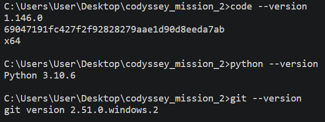
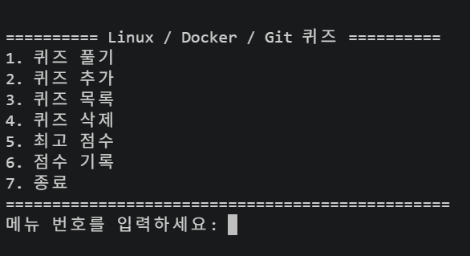

# 🐧 Linux / Docker / Git 퀴즈 게임

## 1. 프로젝트 개요

Linux, Docker, Git의 기본 지식을 복습하는 **Python 콘솔 퀴즈 게임**이다. Python 기초 문법과 객체지향, JSON 파일 입출력, 예외 처리, Git 버전 관리를 실습하는 코디세이 미션 2 프로젝트이다

## 2. 퀴즈 주제 및 선정 이유

- **주제:** Linux / Docker / Git
- **선정 이유:** 미션 1에서 학습한 명령어 및 개념을 복습해보자는 생각으로 선정하였음
- **기본 문제:** Linux 10문제, Docker 10문제, Git 10문제(총 30문제)

## 3. 실행 방법

저장소를 복제한 뒤 프로젝트 **루트 디렉터리**에서 다음 명령어로 실행합니다.

```bash
git clone https://github.com/Gaktsu/codyssey_mission_2.git
cd codyssey_mission_2
python -m src.main
```

## 4. 주요 기능

### 4.1 퀴즈 풀기
- **10 / 20 / 30문제 모드** 중 선택 (등록된 문제가 부족한 모드는 안내 후 재선택)
- 중복 없이 랜덤 출제
- 각 문제에 선택지 4개와 정답 입력(1~4) 제공
- 문제당 힌트 1회 사용 가능; 힌트 사용한 문제를 맞히면 해당 문항 점수에서 10점 감점
- 풀이 완료 시 정답 수, 힌트 사용 수, 최종 점수(100점 만점) 표시
- 게임 도중에는 저장하지 않으며, 완료된 게임만 기록

### 4.2 퀴즈 추가
- 질문, 선택지 4개, 정답 번호(1~4), 힌트 입력
- 빈 값 및 잘못된 번호 검증
- 추가한 퀴즈를 `data/state.json`에 저장

### 4.3 퀴즈 목록
- 등록된 퀴즈의 번호, 질문 및 선택지 목록 확인 (**정답은 표시하지 않음**)
- 등록된 문제가 없으면 안내 메시지 표시

### 4.4 퀴즈 삭제 **보너스 문제 4**
- 목록 번호를 선택한 뒤 삭제 여부 확인(`y`/`n`, 그 외 입력은 재입력)
- 삭제된 결과를 `data/state.json`에 저장

### 4.5 최고 점수 확인
- **10 / 20 / 30문제 모드별** 최고 **최종 점수(0~100점)**와 이니셜 표시
- 동점이면 먼저 기록한 사람을 유지
- 아직 플레이하지 않은 모드는 기록 없음 안내

### 4.6 점수 기록 히스토리 **보너스 문제 5**
- 게임 완료 날짜/시간, 이니셜, 푼 문제 수, 최종 점수 저장
- 모드별 최근 10개 기록을 최신순으로 조회

### 4.7 데이터 저장 및 불러오기
- `data/state.json`: 퀴즈와 힌트
- `data/scores.json`: 모드별 최고 점수 및 플레이 기록
- 첫 실행 시 기본 퀴즈 30개로 시작하고, 빈 점수 파일 생성
- 퀴즈 추가·삭제·게임 완료 시점마다 즉시 저장
- 파일별 누락·손상·읽기/쓰기 오류를 독립적으로 처리

### 4.8 보너스 과제

- 랜덤 출제
- 문제 수 선택
- 힌트 기능
- 퀴즈 삭제 기능
- 점수 기록 히스토리

## 5. 프로젝트 구조

```text
codyssey_mission_2/
├── src/
│   ├── __init__.py
│   ├── main.py
│   ├── quiz.py
│   ├── quiz_game.py
│   ├── input_utils.py
│   └── default_quizzes.py
├── data/
│   ├── state.json          # 퀴즈 데이터
│   └── scores.json         # 최고 점수 및 기록
├── docs/
│   ├── learning/
│   │   └── learning_notes.md   # 과제 목표 개념 정리
│   └── screenshots/            # 실행 화면 스크린샷
├── .gitignore
└── README.md
```

## 6. 데이터 파일 설명

### 6.1 저장 경로와 역할

| 파일 | 역할 |
| --- | --- |
| `data/state.json` | 퀴즈 문제, 보기, 정답 번호, 힌트 |
| `data/scores.json` | 모드별 최고 점수 및 게임별 플레이 기록 |


### 6.2 JSON 데이터 구조

**`data/state.json` 예시**

```json
{
  "quizzes": [
    {
      "question": "현재 작업 경로를 확인하는 Linux 명령어는?",
      "choices": ["ls", "pwd", "cd", "mkdir"],
      "answer": 2,
      "hint": "현재 작업 중인 위치를 화면에 출력합니다."
    }
  ]
}
```

**`data/scores.json` 예시**

```json
{
  "mode": {
    "10": {
      "best_score": {"name": "KMS", "score": 90},
      "scores": [
        {
          "date": "2026-11-10 10:00:00",
          "name": "KMS",
          "total_questions": 10,
          "score": 90
        }
      ]
    },
    "20": {"best_score": null, "scores": []},
    "30": {"best_score": null, "scores": []}
  }
}
```

- `best_score` 초기값: `null` (플레이 기록 없음), 모드 키는 JSON 규칙상 문자열(`"10"`)
- `scores`: 모드별 최근 10개 기록만 보관
- 점수 계산: `(정답 수 × 100 - 힌트를 사용하고 맞힌 문제 수 × 10) // 출제 문제 수` (소수점 버림, 동점은 최고 점수 갱신 아님)
- `"quizzes": []`(퀴즈 전부 삭제)는 정상 상태로 취급하며 기본 문제를 되살리지 않습니다.

## 7. Git 사용 명령어

| 명령어 | 역할 |
| --- | --- |
| `git init` | 현재 폴더를 Git 저장소로 초기화 |
| `git add` | 변경 파일을 커밋 대상(스테이징)에 올림 |
| `git commit` | 스테이징한 변경을 기록으로 저장 |
| `git push` | 로컬 커밋을 원격(GitHub)에 업로드 |
| `git pull` | 원격의 변경사항을 가져와 로컬에 병합 |
| `git checkout` | 브랜치 전환 (`-b`로 새 브랜치 생성) |
| `git merge` | 다른 브랜치의 변경을 현재 브랜치에 합침 |
| `git clone` | 원격 저장소를 로컬에 통째로 복제 |

커밋·브랜치 병합 이력(`git log --oneline --graph`):


## 8. 실행 화면

### 개발 환경 (VSCode / Python / Git 버전)


### 메뉴


### 퀴즈 풀기 (랜덤 출제)


### 퀴즈 추가


### 퀴즈 목록


### 퀴즈 삭제


### 최고 점수


## 9. 학습 정리

과제 목표(Python 기초, 클래스, 파일 입출력, Git)의 개념과 이 프로젝트 코드에서 쓰인 위치: [docs/learning/learning_notes.md](docs/learning/learning_notes.md)
